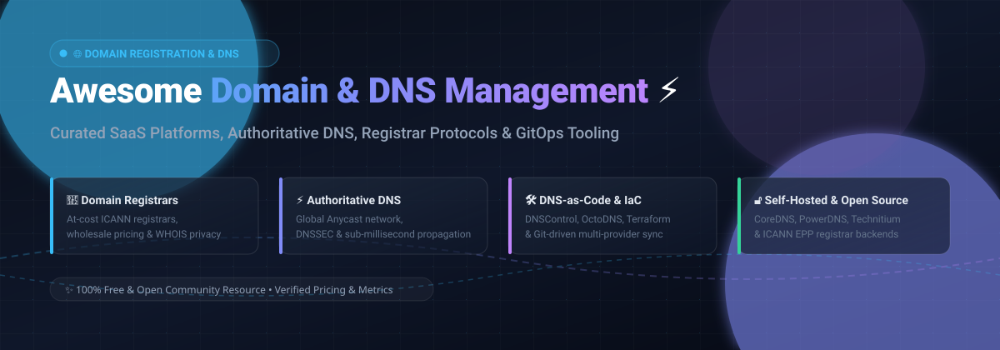

# 🌐 Awesome Domain Registration & DNS Management

  

  
  
  
  
  
  

---

## 🚀 Sector Overview & Market Dynamics

The global domain name and authoritative DNS management market is estimated at **$6.2 Billion to $8.5 Billion**, projected to reach over **$12.5 Billion** by the early 2030s with a 7–9% CAGR. Market dynamics are **moderately fragmented across retail domain registration**—where thousands of accredited registrars compete alongside major consolidation leaders like GoDaddy, Newfold Digital (Bluehost), and Tucows (Hover)—while **highly concentrated (oligopolistic / winner-take-most) in enterprise authoritative Anycast DNS & cloud edge infrastructure**, dominated by hyper-scalers and edge titans such as Amazon Web Services (Route 53), Cloudflare, and Akamai.

---

## 📌 Table of Contents

- [🚀 Sector Overview & Market Dynamics](#-sector-overview--market-dynamics)
- [☁️ SaaS / Hosted Platforms](#️-saas--hosted-platforms)
- [🔓 Open-Source GitHub Projects](#-open-source-github-projects)
- [🛠️ Key Architectural Patterns & IaC](#️-key-architectural-patterns--iac)
- [🤝 How to Contribute](#-how-to-contribute)
- [💖 Support & Sponsorship](#-support--sponsorship)
- [📈 Star History](#-star-history)
- [⚠️ Disclaimer](#️-disclaimer)

---

## ☁️ SaaS / Hosted Platforms

Below is a curated breakdown of industry-leading SaaS and hosted platforms for domain name registration, authoritative DNS management, and DNS edge routing. Sorted in descending order by company scale (market capitalization / valuation / parent annual revenue).

| Product | Scale (Valuation / Revenue) | Description | Pricing (Starting) | Free Tier / Trial Limits |
|:---|:---|:---|:---|:---|
| **[AWS Route 53](https://aws.amazon.com/route53/)** | **~$2.1 Trillion market cap** (Amazon AWS; $105B+ AWS annual revenue) | Enterprise-grade, highly available authoritative Anycast DNS service with health checks, latency routing, and geoproximity routing. | **$0.50/month per hosted zone** (first 25 zones) + **$0.40/million queries** (first 1 Billion standard queries) | **No permanent free tier** for hosted zones; Alias DNS queries routing to AWS native resources (CloudFront, ELB, S3) are **100% free** |
| **[Cloudflare Registrar & DNS](https://www.cloudflare.com/)** | **~$35 Billion market cap** (~$1.7B ARR) | At-cost wholesale domain registrar with zero markup, integrated with Cloudflare's ultra-fast Anycast authoritative DNS edge network, free DNSSEC, and automated SSL/TLS. | **At-cost wholesale** (Registry fee + $0.18 ICANN fee only; e.g. ~$9.77/yr for `.com` with zero markup) | **Free forever plan** with unlimited DNS queries, unlimited records, free DNSSEC, and DDoS mitigation; at-cost domain registration with 0% margin markup |
| **[GoDaddy](https://www.godaddy.com/)** | **~$26 Billion market cap** (~$4.5B annual revenue) | The world's largest ICANN domain registrar managing over 84M+ domain names, comprehensive DNS management, and business hosting services. | **$0.01 for 1st year** for `.com` (with required 2 or 3-year registration commitment; standard renewal ~$21.99/year) | **No permanent free tier**; promotional 1st year pricing discounts available; includes free basic WHOIS privacy protection on eligible domains |
| **[Bluehost](https://www.bluehost.com/)** | **~$3.0 Billion valuation** (Newfold Digital parent group; $1.2B+ revenue) | Major web hosting provider and registrar platform tailored for WordPress sites and small-to-medium businesses. | **$12.99 for 1st year** for `.com` (when bundled with annual hosting from $2.95/mo; renews at $23.99/yr) | **No free-for-ever plan**; offers **30-day money-back guarantee** on hosting and a **1-year free domain registration** voucher with annual hosting plans |
| **[Zoho Domains](https://www.zoho.com/domains/)** | **~$1.2 Billion annual revenue** (Zoho Corp, bootstrapped private entity) | Transparent, developer-friendly domain registrar and DNS management tightly integrated with the Zoho One corporate cloud suite. | **$6.00/year** (for `.fyi`), **$14.00/year** (for `.contact`), standard `.com` at transparent non-promotional renewal rates (~$14–$17/yr) | **No free tier**; domains require upfront annual registration fee; includes free DNS management and WHOIS privacy protection |
| **[Hover](https://www.hover.com/)** | **~$600 Million market cap** (Tucows Inc. parent entity; ~$350M revenue) | Clean, no-upsell domain registration service backed by Tucows, featuring tiered bulk domain discounts and developer APIs. | **~$14.99–$17.99/year** for standard `.com` (volume discounts up to $5 off per domain/year based on portfolio size) | **No free tier**; registration is paid annually; includes free WHOIS privacy protection, two-factor authentication, and bulk tools |
| **[Namecheap](https://www.namecheap.com/)** | **~$250 Million annual revenue** (Privately held registrar) | Popular ICANN-accredited domain registrar and DNS provider with free lifetime WHOIS privacy, dynamic DNS support, and security tools. | **$6.98–$7.48 for 1st year** for `.com` (promotional rate; standard renewal ~$14.58–$15.98/year) | **No free tier**; offers competitive first-year coupons, free lifetime Privacy Protection (WHOIS), and free basic DNS hosting |
| **[DNSimple](https://dnsimple.com/)** | **~$10 Million ARR** (Independent boutique provider) | Developer-first authoritative DNS and domain management with clean REST API, Terraform provider, webhooks, and Secondary DNS. | **Solo: $0/month base** ($0.50/zone/month + $0.10/million queries); **Teams: $29/month** (1 seat, 1,000 records/zone, 99.9% SLA) | **Solo Plan (Free forever base)**: 1 user, 100 records/zone, pay-as-you-go zone fees ($0.50/zone/mo); **30-day free trial** on Team & Enterprise plans (no credit card required) |

---

## 🔓 Open-Source GitHub Projects

Explore the finest open-source DNS servers, registrar backends, GitOps synchronization suites, and DNS-as-Code automation tools. Sorted in descending order by GitHub star count.

| Project | Stars Badge | Description | Primary Language |
|:---|:---|:---|:---|
| **[CoreDNS](https://github.com/coredns/coredns)** |  | Fast and flexible DNS server that chains plugins. CNCF graduated project serving as default cluster DNS in Kubernetes with native authoritative and forwarding capabilities. | Go |
| **[Technitium DNS](https://github.com/TechnitiumSoftware/DnsServer)** |  | Cross-platform, self-hosted DNS server for authoritative and recursive deployments with built-in DoH, DoT, DNSSEC, web UI console, and official Terraform IaC provider. | C# / .NET |
| **[ExternalDNS](https://github.com/kubernetes-sigs/external-dns)** |  | Synchronizes exposed Kubernetes Services and Ingresses dynamically with external DNS providers (AWS Route 53, Cloudflare, Google Cloud DNS, etc.). | Go |
| **[PowerDNS](https://github.com/PowerDNS/pdns)** |  | Enterprise-grade authoritative and recursive DNS server supporting relational databases (MySQL, PostgreSQL), LDAP, and REST API backends. | C++ |
| **[DNSControl](https://github.com/DNSControl/dnscontrol)** |  | Infrastructure-as-Code system by Stack Overflow to manage DNS zones across multiple DNS providers simultaneously using declarative JavaScript/TypeScript definitions. | Go |
| **[OctoDNS](https://github.com/octodns/octodns)** |  | Multi-provider DNS-as-Code framework developed by GitHub to sync DNS configurations across disparate providers via YAML configuration files and automated drift detection. | Python |
| **[getnamingo/registrar](https://github.com/getnamingo/registrar)** |  | Complete open-source ICANN-accredited domain registrar billing and management software platform built upon FOSSBilling. | PHP |
| **[masalachai/epp-client](https://github.com/masalachai/epp-client)** |  | High-performance Extensible Provisioning Protocol (EPP) client library in Rust designed for registry-registrar interactions, domain provisioning, and transfers. | Rust |
| **[BulkDomainAvailabilityChecker](https://github.com/vladmycode/BulkDomainAvailabilityChecker)** |  | High-speed multi-threaded Python utility for checking domain availability across hundreds of TLDs concurrently for SEO and domain prospecting. | Python |
| **[NicTool](https://github.com/msimerson/NicTool)** |  | Authoritative DNS management suite with granular user permissions, web UI, audit logging, and automated export adapters for BIND, PowerDNS, Knot, and NSD. | Perl / JavaScript |
| **[dnsctl](https://github.com/dhivijit/dnsctl)** |  | Git-backed, version-controlled CLI & GUI for Cloudflare DNS with state drift detection, plan/apply execution, and OS-keyring AES-256 encrypted credential storage. | Go |

---

## 🛠️ Key Architectural Patterns & IaC

1. **DNS-as-Code (GitOps)**: Manage DNS records declaratively using **[DNSControl](https://github.com/DNSControl/dnscontrol)** or **[OctoDNS](https://github.com/octodns/octodns)**. Code reviews, PR approvals, and CI/CD pipelines prevent accidental outages and configuration drift.
2. **At-Cost Registrar Economics**: By utilizing wholesale registrars such as **[Cloudflare Registrar](https://www.cloudflare.com/)**, engineering organizations eliminate 200–500% renewal markups charged by legacy retail registrars.
3. **Hybrid Authoritative DNS**: Deploying dual-provider authoritative setups (e.g., Route 53 + Cloudflare) using OctoDNS eliminates single points of failure for mission-critical web applications.
4. **Self-Hosted Data Sovereignty**: Internal and air-gapped environments benefit from **[Technitium DNS](https://github.com/TechnitiumSoftware/DnsServer)** or **[PowerDNS](https://github.com/PowerDNS/pdns)** with native Terraform providers.

---

## 🤝 How to Contribute

We welcome additions, fixes, and updates from the community!

1. 🍴 Fork this repository.
2. 🌿 Create a feature branch: `git checkout -b feature/new-dns-tool`.
3. 📝 Add your entry with factual descriptions, exact pricing/limits, and appropriate star badges.
4. 🚀 Push your branch and open a Pull Request!

---

## 💖 Support & Sponsorship

If you found this curated ecosystem repository useful, please consider supporting the project:

- ⭐ **Star this repository** to help others discover it!
- 🍴 **Fork and share** with colleagues and DevOps teams!
- ☕ **Buy a coffee & sponsor**: [Sponsor Dashboard @ishandutta2007](https://github.com/sponsors/ishandutta2007)

---

## 📈 Star History

---

## ⚠️ Disclaimer

- This is a community-curated collection intended for educational and architectural reference.
- Domain registrar credentials and authoritative DNS control represent vital internet assets. Always enforce Multi-Factor Authentication (MFA), Registry/Registrar Locks, and DNSSEC where supported.
- Renewal pricing frequently differs from first-year promotional prices. Always verify official registry fees, renewal rates, and ICANN terms prior to bulk domain registrations.
